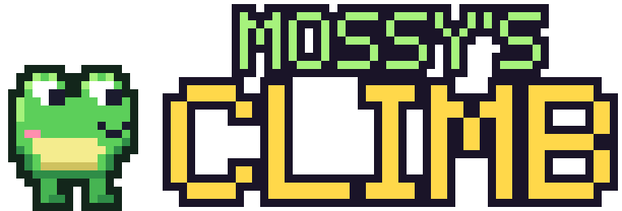
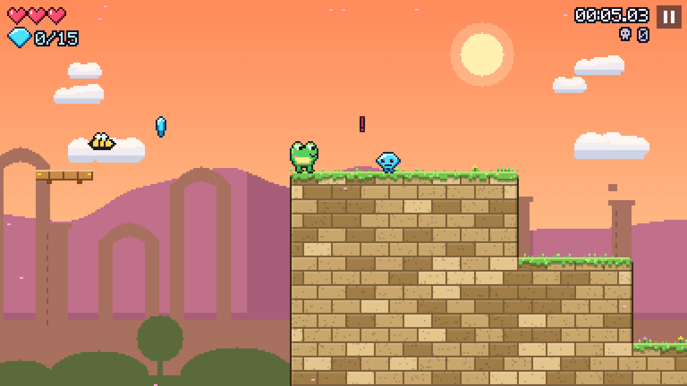
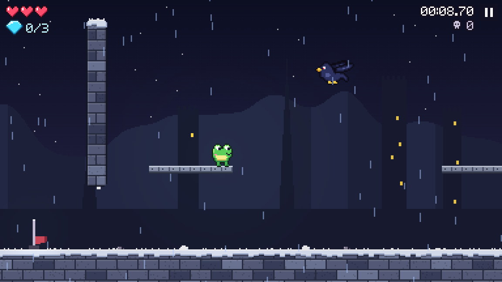
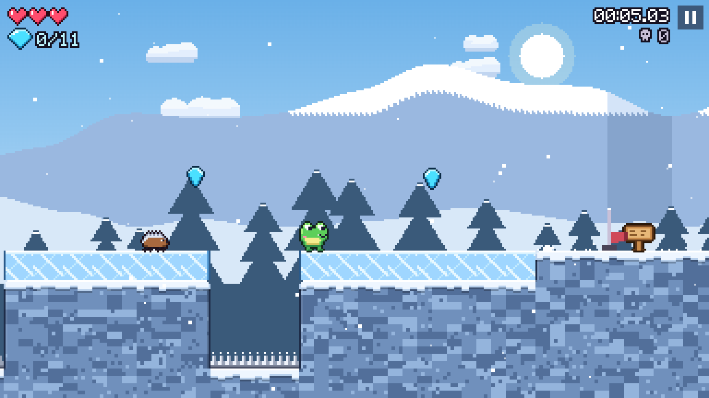
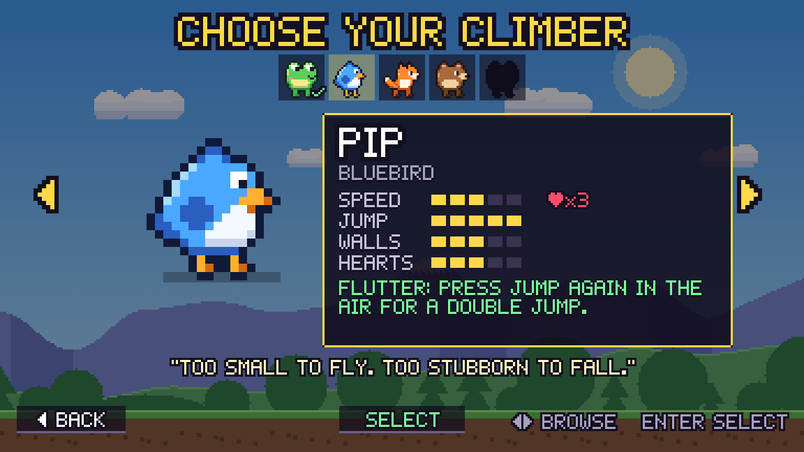

<p align="center">
  
</p>

<p align="center">
  <b>A tiny pixel-art platformer about climbing a very tall mountain.</b><br>
  Stormbeak the thunder crow stole the Dawn Gem and flew to the summit. Go get it back.
</p>

<p align="center">
  <a href="https://razee4315.github.io/mossys-climb/"></a>
  <a href="https://github.com/Razee4315/mossys-climb/releases/latest"></a>
</p>

<table>
  <tr>
    <td></td>
    <td></td>
  </tr>
  <tr>
    <td></td>
    <td></td>
  </tr>
</table>

## What's up the mountain

- **10 levels**, from a sleepy meadow through a runaway sawmill and a cloud garden to a storm-wrapped summit, with a **3-phase boss** at the top.
- **7 climbers**, each with a power: Mossy grips walls, Pip double-jumps, Ember dashes, Bruno slams, Luna glides on her ears and Quill spin-rolls through anything. The seventh is a secret.
- **Power-up orbs:** a Super Star (unstoppable), a Bubble Shield, Sky Wings and a Gem Magnet.
- **Foes with personality:** charging boars, bomb beetles you can kick, shy ghosts, lava leapers, belly-sliding penguins and grumble clouds that call down lightning.
- **Things that don't play fair:** a goal flag that runs away, a beetle parade, a giant saw that chases you, a cloud bridge that melts under your feet, spikes that pop up at the finish, a boulder chase, rising lava and the lights going out.
- **3 stars per level:** finish it, grab every gem, and beat the par time.
- **No engine, no libraries, no image files.** Every sprite, tune and sound effect is generated in code.
- **Every level is proven beatable** by a bot that searches every possible move.

## Controls

| | Keyboard | Phone |
|---|---|---|
| Move | Arrows / WASD | ◀ ▶ on the left (slide between them) |
| Jump (hold = higher) | Space / Z | Tap anywhere on the right |
| Crouch / drop through planks | Down (+ Jump) | Slide your left thumb down (+ jump) |
| Dash / Slam / Roll (Ember, Bruno, Quill) | X / Shift | DASH / SLAM / ROLL button |
| Pause | Esc / P | ❚❚ or the Back button |

Gamepads work too. Progress saves automatically.

<details>
<summary><b>For developers</b></summary>

<br>

```bash
node tools/build.js       # bundle src/ into 04-platformer.html and dist/index.html
node tools/verify.js 4    # prove level 4 is beatable (a few minutes per level)
```

- `src/` holds the game modules and `shell.html`. Never edit `04-platformer.html` by hand.
- `src-tauri/` is the Tauri 2 shell. The Android APK is built **only in GitHub Actions**: every push to `main` bumps the version, builds an arm64 APK, and publishes a release. All Android tweaks live in `tools/android/patch-android.mjs`.
- Optional repo secrets for a permanent signing key: `ANDROID_KEYSTORE_B64`, `ANDROID_KEYSTORE_PASSWORD`, `ANDROID_KEY_ALIAS`, `ANDROID_KEY_PASSWORD`.
- Debug URLs: `?level=3` jumps to a level, `?sprites` (and `?sprites=2`) show the sprite sheets, and `?debug` exposes `window.MC`.

</details>
